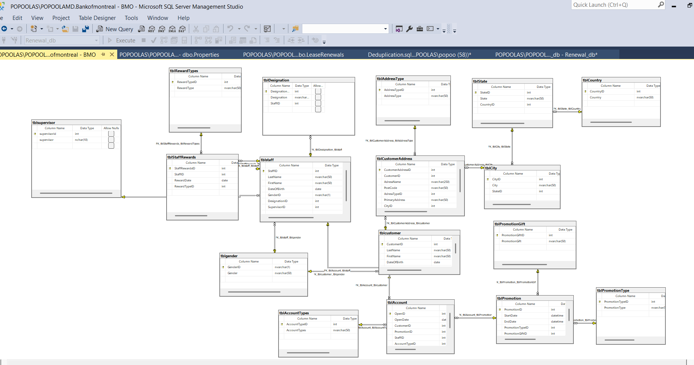

BMO Customer Database Analytics

Independent SQL Server database design and customer analytics project using 1,000 synthetic customer records.

Project Overview

This project demonstrates relational database design, SQL querying, data validation, and customer analytics using Microsoft SQL Server.

Database Design

Designed a relational database model with primary keys, foreign keys, and relationships to support data integrity, analytical querying, and reporting.

Key Skills Demonstrated

* Relational database modelling
* SQL Server
* Primary and foreign keys
* Joins and subqueries
* Data validation
* Customer data analysis
* Analytical reporting
* Data integrity and referential integrity

Project Objectives

* Design a structured relational database
* Apply SQL queries to analyse customer data
* Validate relationships and data consistency
* Generate insights from customer information
* Demonstrate practical SQL and business intelligence skills
